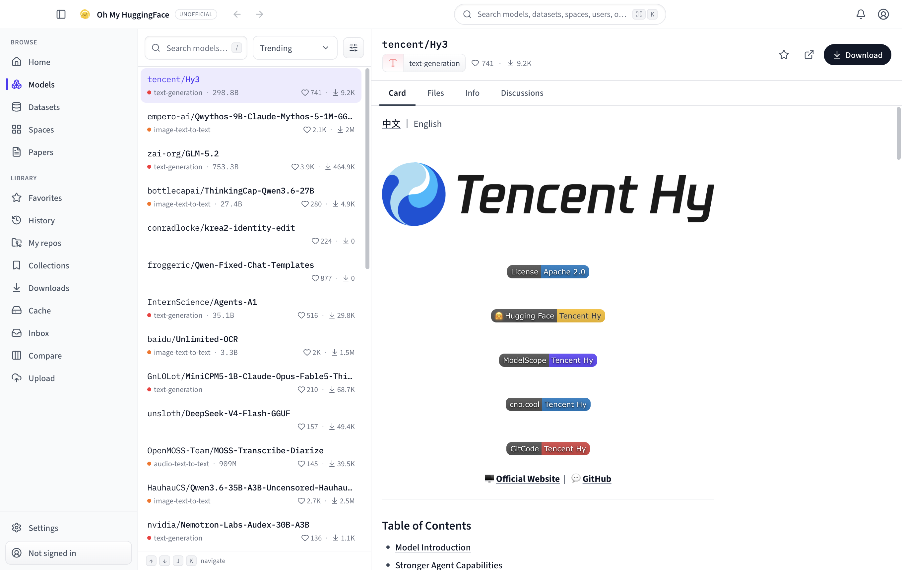

# HubFetch

> [!IMPORTANT]
> **UNOFFICIAL.** HubFetch is an independent, community-built Windows desktop client for the
> Hugging Face Hub. It is **not affiliated with, endorsed by, or sponsored by Hugging Face, Inc.**
> "Hugging Face" is a trademark of Hugging Face, Inc. and is used here only to refer to the service
> this application connects to.

HubFetch is an open-source Windows x64 desktop client for browsing the Hugging Face Hub, managing
large model downloads, running real Git clones, and plugging models into your local AI toolchain.
Releases ship as a single **unsigned Windows x64 ZIP** with no installer and no self-updater.

**Privacy-first: everything stays on your machine.** No telemetry, no analytics, no external
services beyond the Hugging Face API and Git remotes you point at. Your access token is encrypted
with your OS keychain (Electron `safeStorage`) and stored in
`%APPDATA%\HubFetch\credentials.json` with user-only permissions.



## Features

- **Browse** — Models / Datasets / Spaces / Daily Papers in a three-pane, keyboard-first UI with
  virtualized lists, instant model-card rendering (sanitized Markdown), file trees, and metadata.
- **Search everything** — `Cmd/Ctrl+K` command palette: search, filter (task, library, license),
  and sort (trending / likes / downloads).
- **Sign in** — paste a Hugging Face User Access Token; it is encrypted at rest, never stored in
  plaintext, never in `localStorage`. A captured Hub web session adds cookie-backed social writes.
- **Download manager** — parallel, queued downloads with speed limiting, SHA-256 verification, and
  system notifications. Files land in the **standard HF cache layout**, fully interoperable with
  `transformers`, `huggingface-cli`, and friends. Downloads are **independent** of the clone
  subsystem and have their own concurrency.
- **Real Git clones** — clone models/datasets/spaces into a working copy through **system Git and
  system Git-Xet** (prerequisites, see below). Clones run one at a time under a durable scheduler
  with progress, cancellation, and restart recovery.
- **Cache visualizer** — scan your HF cache, see disk usage per repo, and clean stale revisions
  with one click.
- **Follow & inbox** — follow users/orgs/repos and Daily Papers; get system notifications.
- **Compare** — 2–4 models side by side (params, license, downloads, likes).
- **Upload & export** — scan and upload local folders safely; export downloaded files to Ollama,
  LM Studio, or ComfyUI with progress and cancellation.
- **Remote-write features** — discussions and PR comments, notifications, collections, repo
  administration (branches, tags, access requests, settings), Space administration (secrets,
  variables, logs, restart), posts and reactions, upvotes, and profile updates.
- **History** — local, searchable browsing history with repository-type filters.
- **i18n** — English, 简体中文, 繁體中文, 日本語, 한국어, Deutsch, Español, Français, and
  Português (Brasil).
- **Dark & light themes**, native menus, and Windows conventions.
- **Manual updates** — the app does not self-update. New versions are published to GitHub Releases
  and installed by downloading the latest build; no updater or release-feed code ships in the app,
  and the app never phones home for update checks at startup.

## Requirements

- **Windows x64** (Windows 10/11, AMD64). This is the only supported platform; releases are a
  Windows x64 ZIP.
- **Git** installed and on `PATH` — required for the clone feature.
- **Git-Xet** installed and on `PATH` — required for cloning repos that use Git-Xet filters. If a
  repo needs Git-Xet and it is missing, the clone reports a clear readiness error (see the
  Diagnostics page).

HubFetch does **not** bundle Git, Git-Xet, or Git Credential Manager. Open **Settings → Clone
tools** to check readiness, jump to the **official download pages** for any missing tool, and press
**Recheck** after installing. If Recheck still reports a tool missing, restart HubFetch so it picks
up the updated `PATH`.

- **Node.js ≥ 22** and **pnpm ≥ 11** — only needed to build from source, not to run the app.

See [docs/user-guide.en.md](docs/user-guide.en.md) (English) or
[docs/user-guide.zh-CN.md](docs/user-guide.zh-CN.md) (简体中文) for a full walkthrough.

## Install

Grab the latest release for Windows x64 from
[GitHub Releases](https://github.com/OranImp/HubFetch/releases):

- **Windows x64** — `HubFetch-<version>-windows-x64.zip` (unsigned)

### Windows: unsigned ZIP

Release ZIPs are **unsigned**: Windows SmartScreen may show a warning on first launch (see
[docs/signing.md](docs/signing.md)). Extract the ZIP and run `HubFetch.exe`. Releases never include
an installer and the app has **no auto-updater** — install a newer build manually from the GitHub
Releases page when one is published.

## Sign in

Paste a [User Access Token](https://huggingface.co/settings/tokens) in **Settings → Account**.
Prefer a **write** token (or a fine-grained token with the permissions you need) so downloads of
gated repos, discussions, collections, and Hub notifications all work. The token is encrypted with
the OS keychain and stored at `%APPDATA%\HubFetch\credentials.json`. A Hub web session captured
through the app adds cookie-backed social features (posts, reactions, and other write actions).

## Proxies

Network settings offer three closed proxy modes:

- **System** — inherit the OS-level proxy configuration (the default).
- **Direct** — bypass environment, Chromium, and Git-config proxies entirely.
- **Manual** — use a specific HTTP/HTTPS proxy URL (validated, seeded with
  `http://127.0.0.1:7897`).

Proxy choice applies to both Hub API traffic and Git clone child processes. See
[docs/architecture.md](docs/architecture.md#proxy-semantics) for details.

## Security

- **The token** is encrypted with the OS keychain (Electron `safeStorage`) and stored at
  `%APPDATA%\HubFetch\credentials.json` (atomically written with a current-user-only DACL),
  **never plaintext and never in localStorage**. The file lives in the app's data directory, which
  the packaged app and `pnpm dev` share under the HubFetch identity, so they share one login.
  `HUBFETCH_USER_DATA_DIR` and `HUBFETCH_CREDENTIALS_DIR` relocate the data/credentials roots (tests
  use these for isolation). Deleting the file signs you out everywhere.
- **No network calls forward the token cross-host**: the `Authorization` header is only sent to
  `huggingface.co` API hosts, never to the CDN/`resolve` redirect targets.
- **Clone auth boundaries**: Git clones authenticate through system Git (Git Credential Manager /
  SSH) or through a secure, Job-bound app-token AskPass helper. The helper never writes the token to
  disk and refuses requests that do not come from the app's own clone process.
- See [docs/security.md](docs/security.md) for the full security model.

## Diagnostics

The **Diagnostics** page reports cache/disk health, Git and Git-Xet readiness, credential-helper and
SSH availability, endpoint reachability, and proxy status. It can export a **sanitized support
bundle** (a ZIP of redacted logs and structured state) for sharing in bug reports. Secrets are
redacted centrally and the export fails closed if any registered secret leaks in. See
[docs/troubleshooting.md](docs/troubleshooting.md).

## Development

Prerequisites: **Node.js ≥ 22**, **pnpm ≥ 11** (`corepack enable`), a C++ toolchain for native
modules (VS Build Tools on Windows), and Git.

```sh
pnpm install        # installs deps and rebuilds better-sqlite3 + the native bridge for Electron
pnpm dev            # launches the app with hot reload
pnpm test           # unit tests (vitest)
pnpm typecheck      # strict TS across the workspace
pnpm lint           # ESLint (includes hardcoded-string checks for i18n)
pnpm format:check   # Prettier check across the workspace
pnpm build          # production build of every package
pnpm test:docs      # documentation/link/identity/license policy tests
```

Platform packaging (from the repository root):

```sh
pnpm package:win    # unsigned Windows x64 ZIP
```

### Test commands

```sh
pnpm test:no-updater    # negative policy test: no self-update capability remains
pnpm test:privileges    # IPC/CSP privilege-boundary policy test
pnpm test:release-tools # release tooling policy test
pnpm test:docs          # docs link checker + docs contract + notices check + command-reference
```

## Releasing

Releases are cut from `main` by a commit whose subject is `[RELEASE] Vx.y.z`. See
[docs/releasing.md](docs/releasing.md) for the full flow; in short: bump all four workspace manifest
versions, then land a commit titled e.g. `[RELEASE] V0.2.0`. CI verifies the source, builds and
smoke-tests the packaged Windows x64 ZIP before it creates the `v0.2.0` tag or draft release, and a
SHA-256 checksum plus asset inventory are produced for the ZIP. Publishing happens only after the
remote asset list is verified. There is no updater metadata to validate: the app has no self-update
capability (see the manual-updates note above).

## Architecture

```
packages/shared     @hubfetch/shared    shared types + typed IPC contract
packages/hub-api    @hubfetch/hub-api   pure-TS Hub API client (zero Electron deps)
apps/desktop        hubfetch-desktop    electron-vite app (main / preload / renderer)
```

- The **main process** owns all network, downloads, clones, cache scanning, and polling (via
  `hub-api`); heavy work runs in `worker_threads` off the main thread.
- The **renderer** is view-only React (React Router, Zustand, TanStack Query/Virtual, Tailwind,
  Radix). `contextIsolation: true`, `nodeIntegration: false`, `sandbox: true`, strict CSP.
- The whole IPC surface is a **typed contract** in `packages/shared` — no magic strings; every
  handler validates its input.
- Local SQLite (better-sqlite3) stores favorites, history, download tasks, follows, clone state,
  and settings. The token lives only in the separate safeStorage-encrypted credentials file.
- **Downloads and clones are separate subsystems.** Downloads run a parallel, resumable queue; clone
  work runs one task at a time under a durable scheduler with recovery.

See [docs/architecture.md](docs/architecture.md) for the full architecture, including the native
clone bridge and proxy semantics.

## Contributing

See [CONTRIBUTING.md](CONTRIBUTING.md). Translations are especially welcome — locales live in
`apps/desktop/src/renderer/src/i18n/locales/<lang>/` (renderer) and
`apps/desktop/src/main/i18n/locales/` (native menus & notifications).

## Upstream

HubFetch is an independent, community-built fork of the upstream
[Oh My HuggingFace](https://github.com/fzlzjerry/ohmyhf) desktop client
(read-only remote: `https://github.com/fzlzjerry/ohmyhf.git`, Apache-2.0, imported as an untouched
`v0.0.9` snapshot — see [UPSTREAM_SOURCE.md](UPSTREAM_SOURCE.md) for full import provenance). The
upstream remote is kept **read-only**; all HubFetch development happens in this repository at
`https://github.com/OranImp/HubFetch`. Neither project is affiliated with or endorsed by Hugging
Face, Inc. Third-party license and attribution details are in
[THIRD_PARTY_NOTICES.md](THIRD_PARTY_NOTICES.md).

## License

[Apache-2.0](LICENSE). Third-party notices: [THIRD_PARTY_NOTICES.md](THIRD_PARTY_NOTICES.md). Not
affiliated with Hugging Face, Inc.
